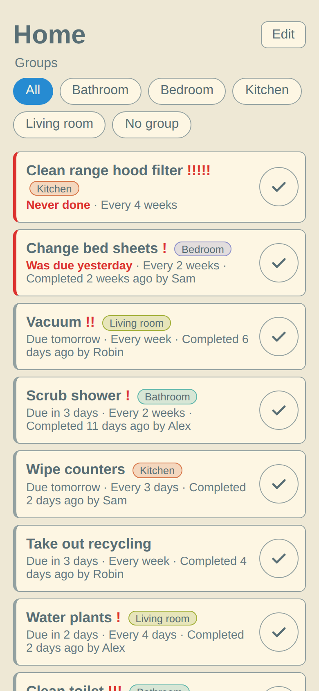

# Sysslor

Sysslor is a chore list where every task has a cadence. Complete "Vacuum" with a cadence of
7 days and it comes back a week later. Tasks that need attention, because they are overdue or
prioritized, are sorted to the top. Changes show up live on every open device. It is built for
one family sharing a single password, and ships as a single small container image backed by
SQLite.

<picture>
  <source media="(prefers-color-scheme: dark)" srcset="docs/screenshots/tasks-dark.png">
  
</picture>

## Running

The container runs as UID 65532, so `/data` must be writable by that user.

With Docker, create a directory owned by that user and bind mount it:

<!-- x-release-please-start-version -->

```sh
mkdir sysslor-data && sudo chown 65532:65532 sysslor-data
docker run -d --name sysslor \
  -p 8080:8080 \
  -v "$PWD/sysslor-data:/data" \
  -e SYSSLOR_ADMIN_PASSWORD='choose-a-password' \
  -e SYSSLOR_COOKIE_KEY="$(openssl rand -base64 48)" \
  ghcr.io/sebastianljunggren/sysslor:0.6.0
```

With Docker Compose, create the directory the same way and use:

```yaml
services:
  sysslor:
    image: ghcr.io/sebastianljunggren/sysslor:0.6.0
    restart: unless-stopped
    ports:
      - 8080:8080
    volumes:
      - ./sysslor-data:/data
    environment:
      SYSSLOR_ADMIN_PASSWORD: choose-a-password
      # Generate once with `openssl rand -base64 48` and keep it.
      SYSSLOR_COOKIE_KEY: paste-the-generated-key-here
```

Instead of the `chown`, you can run the container as yourself with `user: "1000:1000"` (your
`id -u` and `id -g`) and use a directory you own.

With Podman, `:U` on the volume takes care of the ownership:

```sh
podman run -d --name sysslor \
  -p 8080:8080 \
  -v sysslor-data:/data:U \
  -e SYSSLOR_ADMIN_PASSWORD='choose-a-password' \
  -e SYSSLOR_COOKIE_KEY="$(openssl rand -base64 48)" \
  ghcr.io/sebastianljunggren/sysslor:0.6.0
```

With Kubernetes, create the secret first, so it stays out of the manifest:

```sh
kubectl create secret generic sysslor \
  --from-literal=admin-password='choose-a-password' \
  --from-literal=cookie-key="$(openssl rand -base64 48)"
```

Then apply a manifest like this one. `fsGroup` takes care of the ownership:

```yaml
apiVersion: v1
kind: PersistentVolumeClaim
metadata:
  name: sysslor-data
spec:
  accessModes:
    - ReadWriteOnce
  resources:
    requests:
      storage: 1Gi
---
apiVersion: apps/v1
kind: Deployment
metadata:
  name: sysslor
spec:
  # SQLite cannot have two writers: one replica, and stop it before starting a new one.
  replicas: 1
  strategy:
    type: Recreate
  selector:
    matchLabels:
      app: sysslor
  template:
    metadata:
      labels:
        app: sysslor
    spec:
      securityContext:
        runAsNonRoot: true
        runAsUser: 65532
        runAsGroup: 65532
        fsGroup: 65532
        seccompProfile:
          type: RuntimeDefault
      volumes:
        - name: data
          persistentVolumeClaim:
            claimName: sysslor-data
      containers:
        - name: sysslor
          image: ghcr.io/sebastianljunggren/sysslor:0.6.0
          ports:
            - name: http
              containerPort: 8080
          env:
            - name: SYSSLOR_ADMIN_PASSWORD
              valueFrom:
                secretKeyRef:
                  name: sysslor
                  key: admin-password
            - name: SYSSLOR_COOKIE_KEY
              valueFrom:
                secretKeyRef:
                  name: sysslor
                  key: cookie-key
          volumeMounts:
            - name: data
              mountPath: /data
          livenessProbe:
            httpGet:
              path: /healthz
              port: http
          readinessProbe:
            httpGet:
              path: /healthz
              port: http
          resources:
            requests:
              memory: 16Mi
              cpu: 10m
            limits:
              memory: 128Mi
          securityContext:
            allowPrivilegeEscalation: false
            readOnlyRootFilesystem: true
            capabilities:
              drop:
                - ALL
---
apiVersion: v1
kind: Service
metadata:
  name: sysslor
spec:
  selector:
    app: sysslor
  ports:
    - name: http
      port: 80
      targetPort: http
```

Expose the Service through your ingress with TLS, and see the deployment notes below.

<!-- x-release-please-end -->

Keep `SYSSLOR_COOKIE_KEY` stable across restarts, or everyone gets logged out.

## Configuration

All configuration is read from environment variables.

| Variable                  | Default                                          | Description                                                                                         |
| ------------------------- | ------------------------------------------------ | --------------------------------------------------------------------------------------------------- |
| `SYSSLOR_ADMIN_PASSWORD`  | required                                         | The shared login password.                                                                          |
| `SYSSLOR_COOKIE_KEY`      | required                                         | Key for signing session cookies, at least 32 bytes. Generate one with `openssl rand -base64 48`.    |
| `SYSSLOR_TIME_ZONE`       | `Europe/Stockholm`                               | Time zone used to decide which calendar day a task is due.                                          |
| `SYSSLOR_LOCALE`          | `en`                                             | Language used to sort names (groups, tasks). This is the collation language, not the UI language.   |
| `SYSSLOR_BIND_ADDR`       | `0.0.0.0:8080`                                   | Address to listen on.                                                                               |
| `SYSSLOR_DATABASE_URL`    | `sqlite:///data/sysslor.db` in the image         | SQLite database location.                                                                           |

## Deployment notes

- Serve it over HTTPS (or `localhost`). The session cookie is `Secure`, so logging in over plain
  HTTP will not work.
- Run a single instance. SQLite cannot have two writers, so use one replica and stop the old
  container before starting a new one.
- Disable proxy buffering for `/api/events`, which is a Server-Sent Events stream used for
  live updates.
- Put the database on local or block storage, not NFS. SQLite file locking does not work
  reliably on NFS.

## License

Licensed under either of

- Apache License, Version 2.0 ([LICENSE-APACHE](LICENSE-APACHE) or
  <https://www.apache.org/licenses/LICENSE-2.0>)
- MIT license ([LICENSE-MIT](LICENSE-MIT) or <https://opensource.org/licenses/MIT>)

at your option.

Unless you explicitly state otherwise, any contribution intentionally submitted for inclusion
in the work by you, as defined in the Apache-2.0 license, shall be dual licensed as above,
without any additional terms or conditions.
